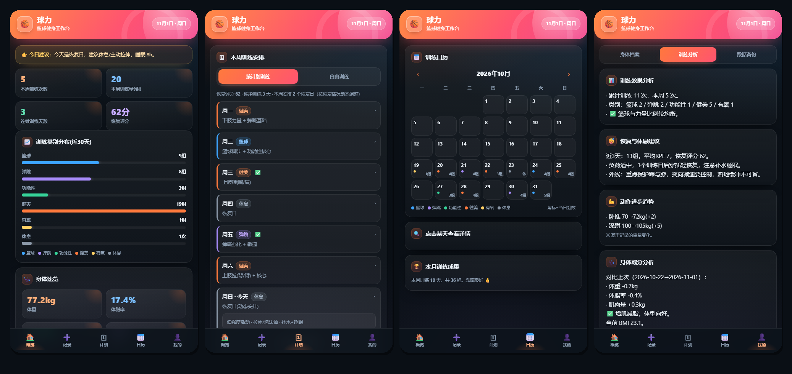

# 🏀 球力 · 篮球健身工作台

**一个单文件的篮球 + 健身训练记录工具。打开网页就能用，数据只存在你自己的设备里。**

不注册、不登录、不上传、没有后端。把网页存到手机主屏幕，它就是一个独立的训练 App。

[**▶ 直接打开使用**](https://zh666524.github.io/ball-fit/) · [自己部署一份](#自己部署一份) · [数据与隐私](#数据与隐私)

---

## 它能做什么

**记录** —— 篮球、弹跳、功能性、健美力量、有氧、休息六类。动作、重量、组数、次数、时长、RPE 主观强度、备注，一条记录半分钟。内置 40+ 常用篮球与力量动作，点一下自动填入。

**计划** —— 按恢复情况动态排每周安排：连续训练多、RPE 高、缺少恢复日，就自动插入恢复日。每个动作会按你的历史记录推算今天的推荐重量（渐进超负荷；上次 RPE ≥ 9 就提示保重或减重）。

**恢复评分** —— 根据最近 3 天的组数、平均 RPE 与休息情况给出 0-100 的评分，反过来影响计划与今日建议。

**日历** —— 月份视图，每天用彩色圆点标记训练类型，右下角是当天总组数，一眼看出这个月练了几天、哪几天断了。

**身体数据** —— 身高体重位置档案、体脂秤数据（体重 / 体脂率 / 肌肉量 / 水分 / 骨量 / 内脏脂肪 / 基础代谢）、体重与体脂趋势曲线、增肌减脂判断。

**分析** —— 训练类别配比是否均衡、各动作的重量进步曲线、恢复与休息建议、身体成分对比。

**备份** —— 一键导出 CSV，换设备时导入即可。

## 手机上安装

打开上面那个链接，然后：

- **iPhone**：Safari 底部「分享」→ 添加到主屏幕
- **安卓**：Chrome 右上角「⋮」→ 添加到主屏幕 / 安装应用
- **电脑**：直接用浏览器打开，或按 `Ctrl/Cmd + D` 收藏

装完图标名是「球力」，点开全屏无地址栏。第一次联网打开后，断网也能用（Service Worker 缓存）。

## 数据与隐私

这一点很重要，先说清楚：

- **没有服务器，没有账号，没有任何数据上传。** 训练记录存在浏览器的 `localStorage` 里。
- 所以**换设备不会自动同步**。要迁移就「我的 → 数据备份 → 导出 CSV」，在新设备导入。
- **清理浏览器数据 / 卸载浏览器 / 换手机，数据会丢**，记得定期导出。
- 数据是「浏览器 + 域名」私有的：别人打开同一个链接，看到的是一个干净的新实例，看不到你的任何记录。

## 自己部署一份

不需要装任何东西，也不需要构建工具。

**方式一：GitHub Pages（推荐）**

1. 右上角 **Fork** 这个仓库
2. 仓库 **Settings → Pages** → Source 选 `Deploy from a branch`，分支 `main`、目录 `/ (root)` → Save
3. 等 1 分钟，访问 `https://<你的用户名>.github.io/ball-fit/`

**方式二：任何静态托管**

整个项目就是 `index.html` + `icon-180.png` + `manifest.webmanifest` + `sw.js` 四个文件，丢到任意静态托管（Vercel / Netlify / Cloudflare Pages / 自己的服务器，甚至本地双击打开）都能跑。没有构建、没有依赖、没有外链 CDN。

> 本地双击打开时 Service Worker 不生效（`file://` 限制），其他功能正常；要用「添加到主屏幕」请走 http(s)。

## 技术细节

- **单文件**：所有 HTML / CSS / JS 都在这一个 `index.html` 里（约 58 KB），零框架、零依赖、零网络请求
- **PWA**：`manifest.webmanifest` + `sw.js`，支持添加到主屏幕、全屏运行、离线可用（网络优先策略，联网时自动拿新版）
- **存储**：`localStorage`，键名 `bball_fitness_v3`，结构为 `{profile, records, body, plan, cal}`
- **兼容**：iOS Safari 15+ / Android Chrome 90+ / 桌面 Chrome、Edge、Safari、Firefox 近两年版本

想改文案或配色，直接在 `index.html` 顶部 `<style>` 的 `:root` 里改变量即可，例如 `--accent`、`--accent2` 是主色渐变。

## 说明

训练建议基于通用的负荷渐进与恢复原则做启发式推算，**不构成医疗或康复建议**。有伤病史、关节问题请先咨询专业人士。

## License

[MIT](LICENSE) —— 随便用、随便改、随便商用，保留版权声明即可。
